# ps5-discord

Native Discord client for PS5. A native app (title PPSA99072) draws the UI; a
background core payload, which the app starts itself, holds the Discord session.

Status: alpha. [0.5.0-alpha.1](https://github.com/abhi245y/ps5-discord/releases/tag/v0.5.0-alpha.1)
is the latest release: text chat, voice calls, Go Live, notifications and updates from inside
the app. Something not working? See [TROUBLESHOOTING.md](TROUBLESHOOTING.md).

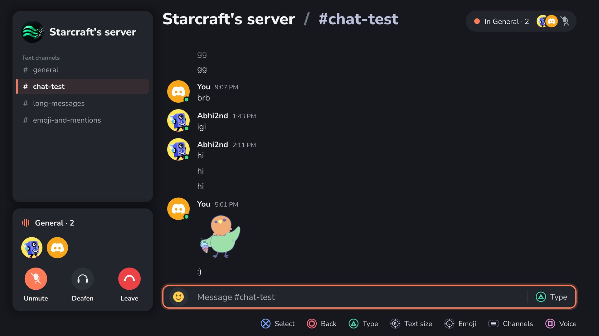

## Screenshots

| | |
|---|---|
| 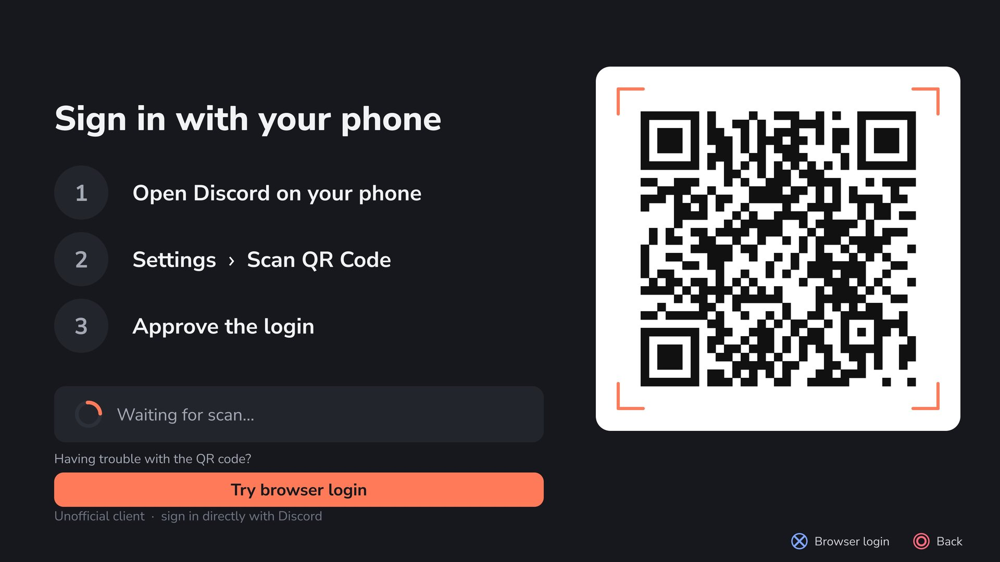 Sign in by scanning a QR code | 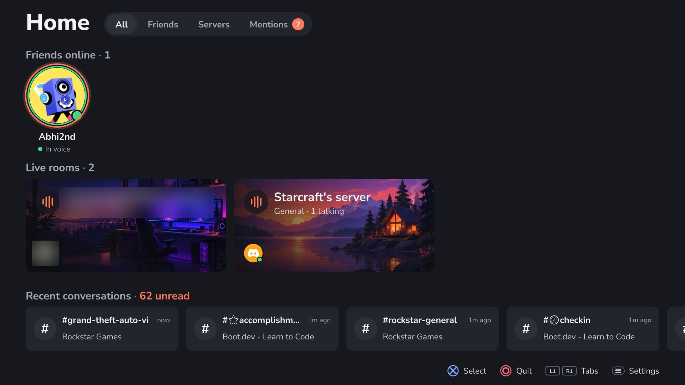 Home: friends online, live voice rooms, recent chats |
| 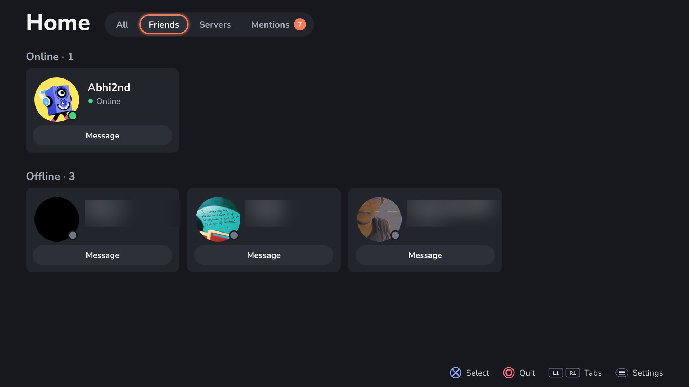 Friends | 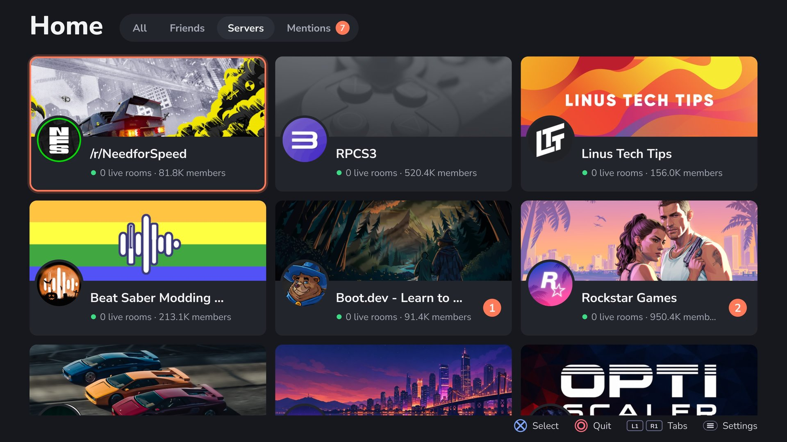 Servers |
| 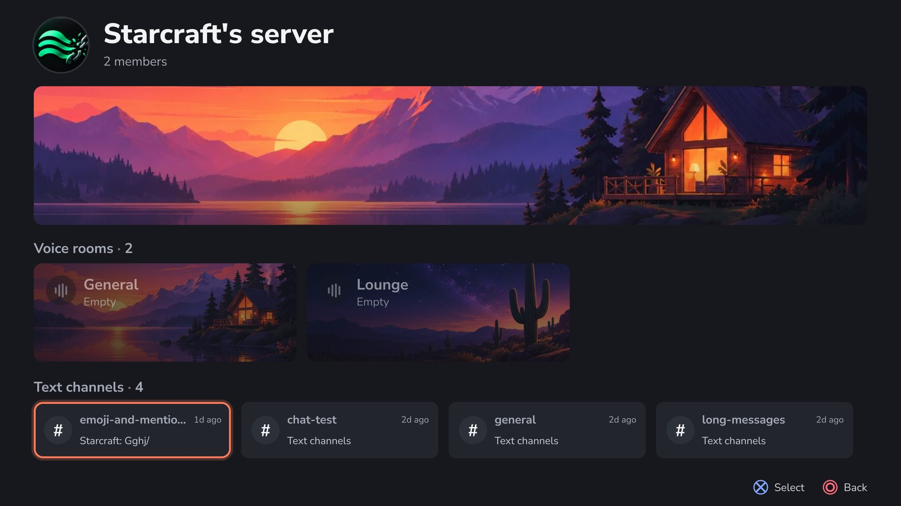 A server: voice rooms and text channels | 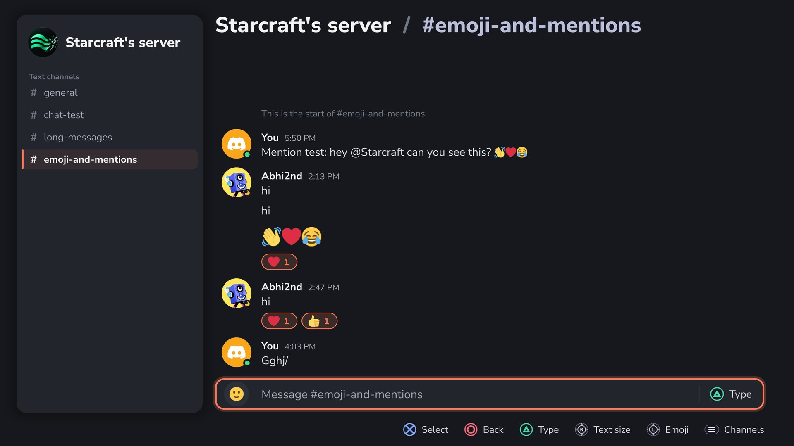 Chat with emoji and reactions |
| 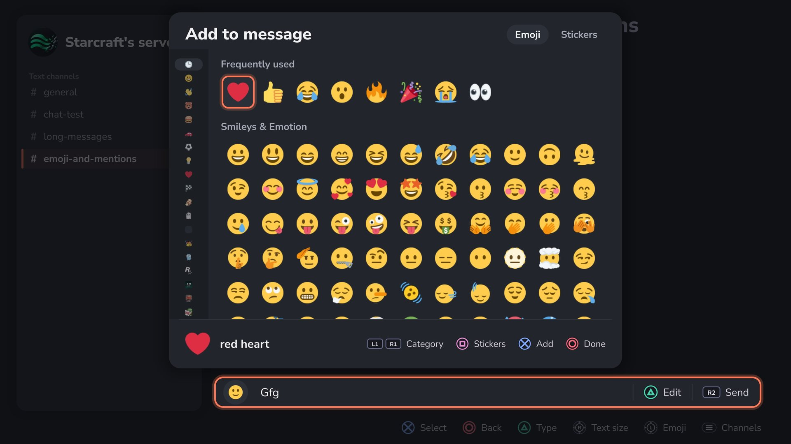 The emoji picker | 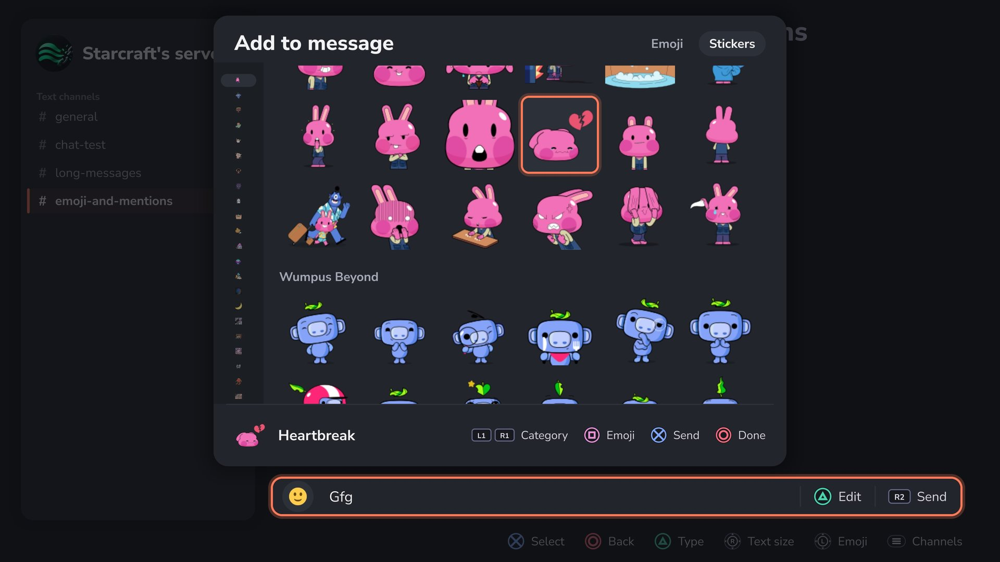 Stickers |
| 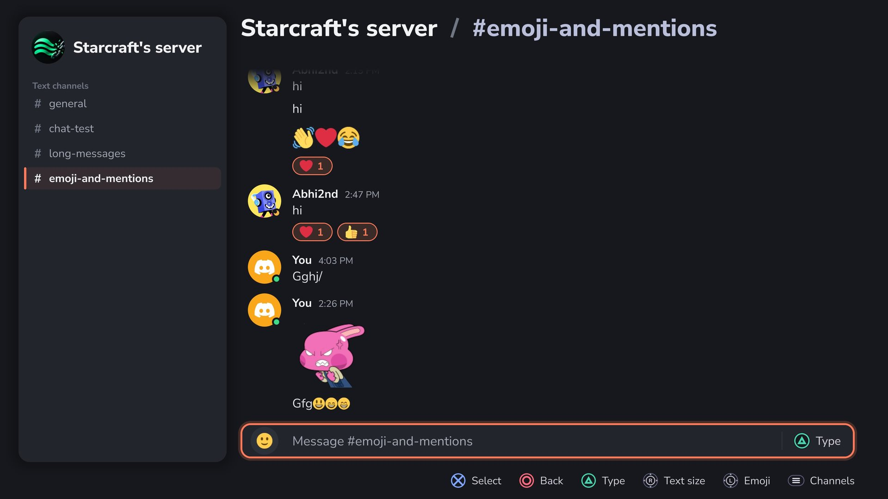 A sticker in the chat | 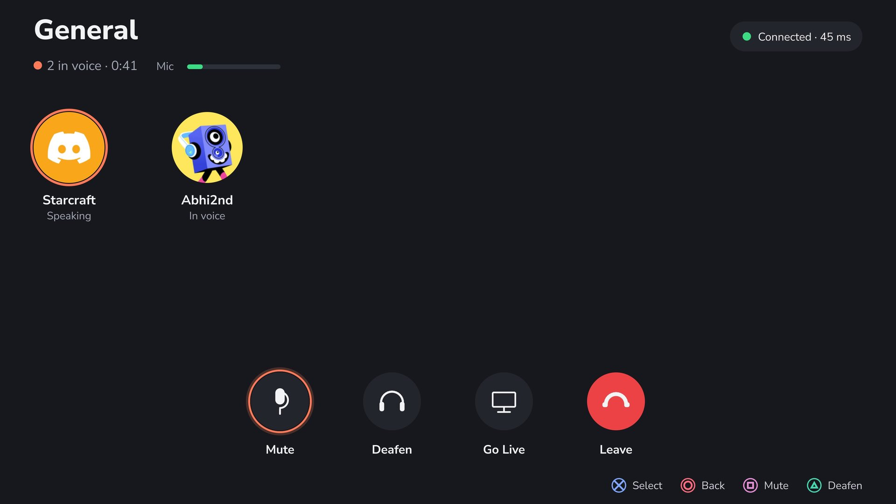 A voice call, with Go Live |
| 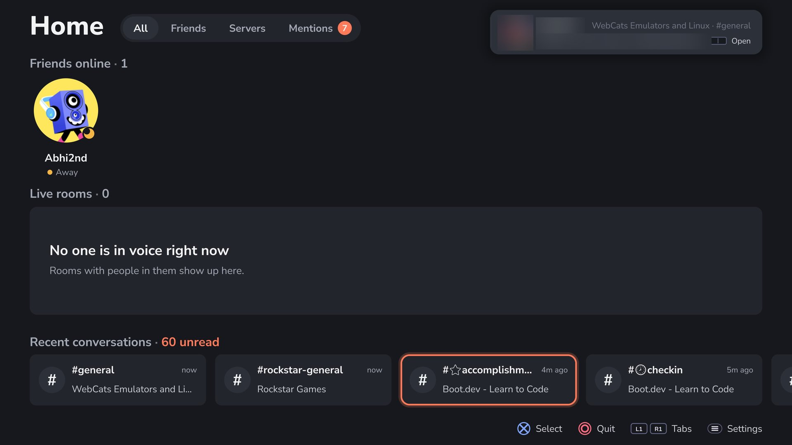 A message banner | 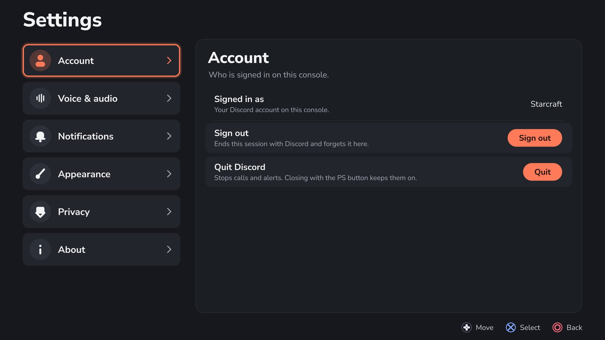 Settings |

Guides: [voice calls and Go Live](VOICE_AND_GO_LIVE.md), [troubleshooting](TROUBLESHOOTING.md).

## What works

- QR code login: no password or token typing, scan with the Discord mobile app
- Home with friends online, live voice rooms and recent chats; Friends, Servers, Mentions tabs
- Server pages, channel chat and DMs: read, send, reply, react, edit and delete your own
- The PS5 system keyboard on Triangle (the app's own keyboard as a fallback)
- Avatars, server icons, banners, image previews (full screen from a message's menu), many scripts
- Colour emoji as Discord draws them, an emoji picker (L3 in a chat), reactions with any
  emoji, server emoji, and stickers (animated ones too)
- Voice: server voice channels and DM calls, with Discord's end-to-end encryption (DAVE),
  mute and deafen. The call stays up while a game covers the app.
- Go Live: stream the game you are playing into the call (1280x720 H.264 at 30 fps and the
  game's sound, end-to-end encrypted). The picture comes from a Remote Play session with the
  console itself; the DualSense, plugged in by USB, plays the game through it and is your
  headset (its mic and its speaker or headphones) while you are live.
- Notifications: banners for DMs and mentions in the app, and the PS5's own alerts while the
  app is not in front (home screen, a game). Discord's mutes are followed; quiet hours and
  per-kind switches in Settings, Notifications.
- "Playing" on Discord: the game in front on the PS5 shows on your profile with its cover.
  Settings, Privacy turns it off.
- One Discord sign-in per console user: switch users on the PS5 and the app follows.
- Updates: Settings, About, Updates checks this project's GitHub releases, downloads a signed
  one in the background and installs it when you restart the app. Previous version, Roll back
  puts the version before it back.

## Build

Builds on Linux with clang (no llvm-devel needed).

```sh
make deps                        # pinned ps5-payload-sdk, mbedTLS, zlib, cJSON, qrcodegen, SQLite
make dave                        # OpenSSL + mlspp + libdave into .deps/dave (slow; needs full perl)
make                             # build/ps5-discord.elf
make test                        # host self-checks
cd app && make                   # app folder in app/dist/PPSA99072, core bundled (build it first)
make deploy PS5_HOST=<ps5-ip>    # stop the running copy, send a development core (CORE_LAN=1) to elfldr (9021)
make stop PS5_HOST=<ps5-ip>
```

`make deploy` always sends a development core, which also answers `make stop` and
`/api/state` from the LAN; the core inside a release (`make release`) answers only the app.

`make host` builds the same core for Linux (state in the current directory) for
testing against Discord without the console.

**Voice needs libdave.** Since March 2026 Discord refuses voice calls (all but stage
channels) from clients without DAVE end-to-end encryption. `make deps` does not fetch
it: run `make dave` once per machine. Without `.deps/dave` the build still succeeds and
the tests still pass, but it links a no-DAVE stub and every voice join fails (close code
4017). Before any release or a build on a fresh machine, run `make dave` and check the
"building the no-DAVE stub" warning does not appear.

## Use

1. Copy the `PPSA99072` folder from the app zip to `/data/homebrew/` on the console (FTP).
2. Run kstuff and ShadowMount so the folder shows up as a title, then launch it from the
   home screen. The app starts the core itself through elfldr (port 9021), so elfldr must
   be running.
3. Scan the QR code it shows: Discord app, Settings, Scan QR Code.
4. If QR login fails, press Cross on **Try browser login**. Sign in on Discord's website,
   complete any verification, then close the browser to return. The core imports and
   validates the active console user's browser session automatically, including an
   existing signed-in session. Closed the browser too soon? Cross opens it again; Square
   cancels and returns to QR login.
5. The sign-in is kept in `/data/ps5-discord/token-<console user>`, encrypted with a key
   tied to this console; later runs skip the QR. Each console user signs in to their own
   Discord account.

### Updating

From 0.5.0-alpha.1 on, the app updates itself:

1. Settings (Options on Home), About, Updates, **Check**. A release build also checks once
   when it starts and shows an offer only when there is one.
2. **Update** downloads it in the background (the app keeps working), then **Restart now**
   closes the app; the files are swapped once it is closed. A call or Go Live ends first.
3. Open the app again. Until the next update, Settings, About, **Previous version, Roll
   back** puts the version before it back the same way.

An older version (0.2.0-alpha.1) cannot update itself: install 0.5.0-alpha.1 by FTP as in
step 1 above, over the old folder.

Browser login is experimental. It waits up to ten minutes, reads
WebKit storage without modifying it, and saves the validated session atomically
with owner-only permissions. No watchdog is used. Tested with a real human
verification challenge.

## Known limitations

- The core's control API (port 9041) answers only the app on the console (127.0.0.1);
  a development build (`CORE_LAN=1`) also lets the LAN read its status and stop it with the
  key. The app proves itself with a key the core writes at each start to
  `/data/homebrew/PPSA99072/control.key`; `GET /api/state` (version and sign-in state) needs
  none. The file is readable by any user (the app runs as another user than the core), so
  another payload, homebrew app or anyone on the console's FTP server can read it: the key
  keeps out the browser and the LAN, not other homebrew.
- Updates come only as releases on this project's GitHub page, signed with the project's
  offline keys; the core installs nothing else. A check sends the console's IP address to
  api.github.com. A version you rolled back is not offered at launch again (Check in
  Settings still offers it). Someone holding the GitHub account could put back an older
  signed release that is still newer than a console's version. Nothing rolls back by
  itself: if a new version does not open at all, copy a release zip's PPSA99072 folder over
  the app by FTP ([TROUBLESHOOTING.md](TROUBLESHOOTING.md#updates)).
- Third-party clients break Discord's ToS and can get an account banned.
- Go Live needs the DualSense on USB (a Bluetooth controller is dropped by Remote Play) and a
  Remote Play pairing, made once in Settings, Voice & audio. Above 720p30 needs Nitro or a
  boosted server. After a Go Live, replug the controller before the next one (the app asks).
- During a game the mic is only available through Go Live (the console refuses payloads the
  mic); outside it, voice needs the app on screen.

## Target

- Console firmware 13.00 (never install or trigger >= 14.00)

## Workflow

- `main` stays releasable; work goes on `feat/*` and `fix/*` branches off `develop`, and
  `develop` goes to `main` once it is tested on the console. A release is built and signed
  from a `release/vX.Y.Z` branch cut from `main`.
- Versioning, release channels and milestones: [ROADMAP.md](ROADMAP.md). Changes: [CHANGELOG.md](CHANGELOG.md).


## License

ps5-discord is free software under the GNU Affero General Public License, version 3 or
later ([LICENSE](LICENSE)). The app builds on the ps5-homebrew-ui kit by BlackBearReloaded;
those files keep their GPL-3.0-or-later headers ([app/LICENSE.GPL-3.0](app/LICENSE.GPL-3.0),
[app/THIRD_PARTY_NOTICES.md](app/THIRD_PARTY_NOTICES.md)) and are combined with the AGPL code
under GPLv3 section 13. The app's About page links to this source.

The core includes the Remote Play client from chiaki-ng (`third_party/`, see
[third_party/README.md](third_party/README.md)), which is AGPL-3.0-only, so the core as built
is distributed under AGPL-3.0-only as a whole.
