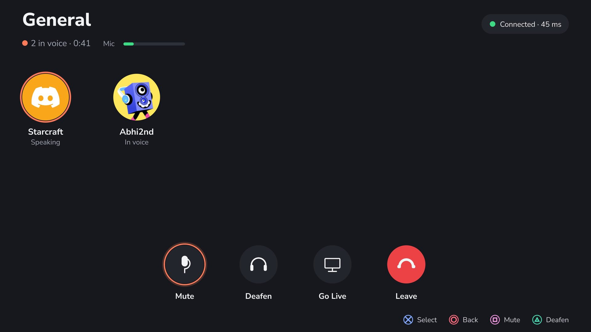
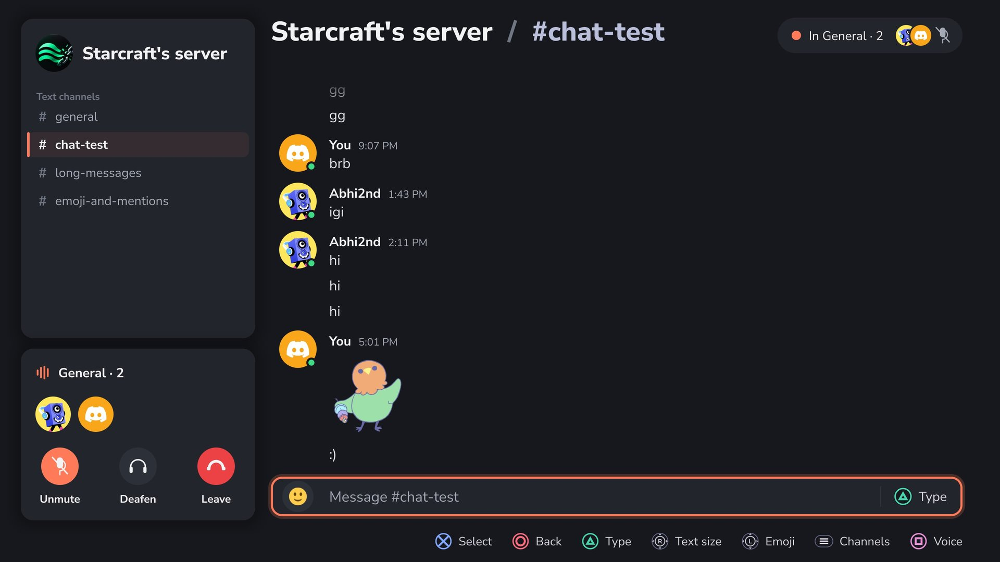

# Voice calls and Go Live

How to talk in Discord voice from the PS5, and how to stream your game into the call.
Something going wrong? See [TROUBLESHOOTING.md](TROUBLESHOOTING.md#voice).

## Voice calls

### Joining

- **A server's voice room:** Home, under **Live rooms** (rooms with people in them), or open
  a server and pick a room under **Voice rooms**. Cross joins.
- **A DM call:** open the DM and press Square (**Call**). When someone calls you, the app
  shows **Incoming call**: Cross answers, Circle declines.

The room shows who is in it and who is speaking, your mic level, and the connection with its
ping (top right). Calls are end-to-end encrypted (Discord's DAVE), like on the desktop app.

### In the room

| Button | Does |
|---|---|
| Square | Mute or unmute your mic |
| Triangle | Deafen: you hear nothing |
| Cross on **Go Live** | Stream your game into the call ([below](#go-live)) |
| Cross on **Leave** | Leave the call |
| Circle | Back to the app; the call stays up |

You can chat while you talk: in a server's chat the call sits under the channel list
(Unmute, Deafen, Leave), the top right shows who is in it, and Square (**Voice**) opens the
room.

Settings, **Voice & audio**: **Mic gain** (how loud you are; join a call to see your level
there), **Call volume** (how loud the call is for you), and **Controller audio**.
Controller audio defaults to Off. Turn it On to automatically use a USB-connected
DualSense microphone and speaker during calls, including while a game is in front.
Use a USB data cable and set controller communication to **Use USB Cable**.
Turning it Off or leaving the call releases the controller; press PS to wake it afterward.
The choice is saved per console user. Remote Play temporarily reserves the controller
for its own audio path.
PS opens the control center while audio stays active. Create, motion sensing and
touchpad coordinates are not forwarded; the touchpad click is supported.

### Things to know

- **Without an external audio device, the app must be on screen for you to talk and hear.**
  When a game is in front, the console does not give the app the mic or the sound. To talk
  while you play, enable **Controller audio** with a USB cable, use a Bluetooth headset
  through the USB adapter, or [Go Live](#go-live)
  with **Remote Play (legacy)**: there the USB controller is your headset. The default
  hardware encoder capture does not take over controller audio.
- **What ends a call:** Leave, Settings, Account, **Sign out** or **Quit Discord**, and
  **Restart now** or **Roll back** in Settings, About. Closing the app with the PS button does
  not end it.

## Go Live

Go Live streams what the PS5 shows into the call, picture and game sound, end-to-end
encrypted. Viewers watch it like any Discord stream, on a PC or phone.

By default, **Hardware encoder** uses the console's own encoder for the picture and the
core's game-audio capture for sound. The controller stays wireless if you use it that way;
plugging it in does not change capture method. No Remote Play pairing is needed.

### Before the first time

1. **Pick a quality:** Settings, **Go Live**, **Quality**. 720p · 30 fps works for everyone.
   Higher qualities may need Nitro or a boosted server, and Discord may act on an account
   that streams above its limits.
2. **Optional legacy method:** Settings, Go Live, **Capture method**, **Remote Play (legacy)**.
   This needs a DualSense plugged in by USB, Remote Play enabled in PS5 Settings, System,
   Remote Play, and a console user signed in to PSN.
3. **For Remote Play only, pair once per console user:** Settings, Go Live, **Pairing**.
   Pick yourself (only the user on screen can pair). The app asks the PS5 for a code by
   itself; if that fails, Square (**Enter a PIN**) and type the 8 digits from PS5 Settings,
   System, Remote Play, **Link Device**. Missing USB or pairing is an error; capture never
   silently switches methods.

Remote Play as the user on screen takes over the USB DualSense: its buttons play the game
through that session, its mic feeds the call, and its speaker or plugged-in headphones play
the call. A session as another console user leaves the controller alone.

### Going live

1. Join a voice room or a DM call. For Remote Play, plug the DualSense in by USB first.
2. In the room, Cross on **Go Live**. The room shows "Going live…", then "Live". During
   Remote Play controller takeover it also says the controller is the headset and plays
   the game; the lightbar turns teal with player 1's light.
3. Go to your game and play. Your friends see it in the call.
4. To stop, come back to the room and press **Stop live**, or Leave.

### Things to know

- **Viewers see the screen, not only the game:** the app, menus and PS5 alerts too. Settings,
  Notifications, **Alerts during Go Live** is off unless you turn it on, so message alerts
  stay off your stream. Games and scenes that block Remote Play or screen sharing may show viewers a
  black picture.
- **Remote Play only: replug the controller between Go Lives.** When Remote Play ends, it
  gives the controller back to the console. Before the next Go Live, unplug its USB cable and plug it back in; the
  app asks you to. If you skip it, pressing the PS button while live can make the console ask
  "Who's using this controller?", and answering ends the stream.
- **During Remote Play controller takeover, your PS button and controller** go through the
  session, so everything takes a moment longer than usual.
- **Network:** a stream at 720p · 30 fps sends about 2.5 to 5 Mbit/s. A wired connection
  helps.
- **When Go Live stops by itself** (the network drops, Remote Play ends), the app shows why in
  the room and the stream ends in the call too. For Remote Play, replug the controller
  before trying again.
- **If the controller is dead after a Remote Play Go Live**, unplug it and plug it back in.
  If the core was stopped while it held the controller, a reboot frees it.
